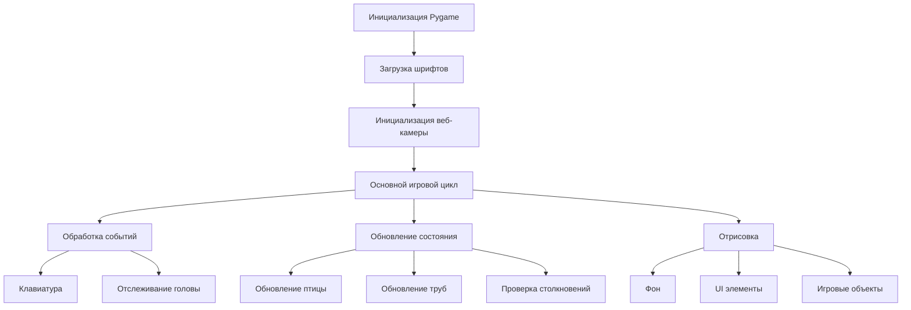
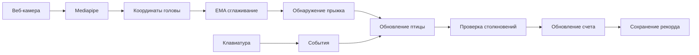
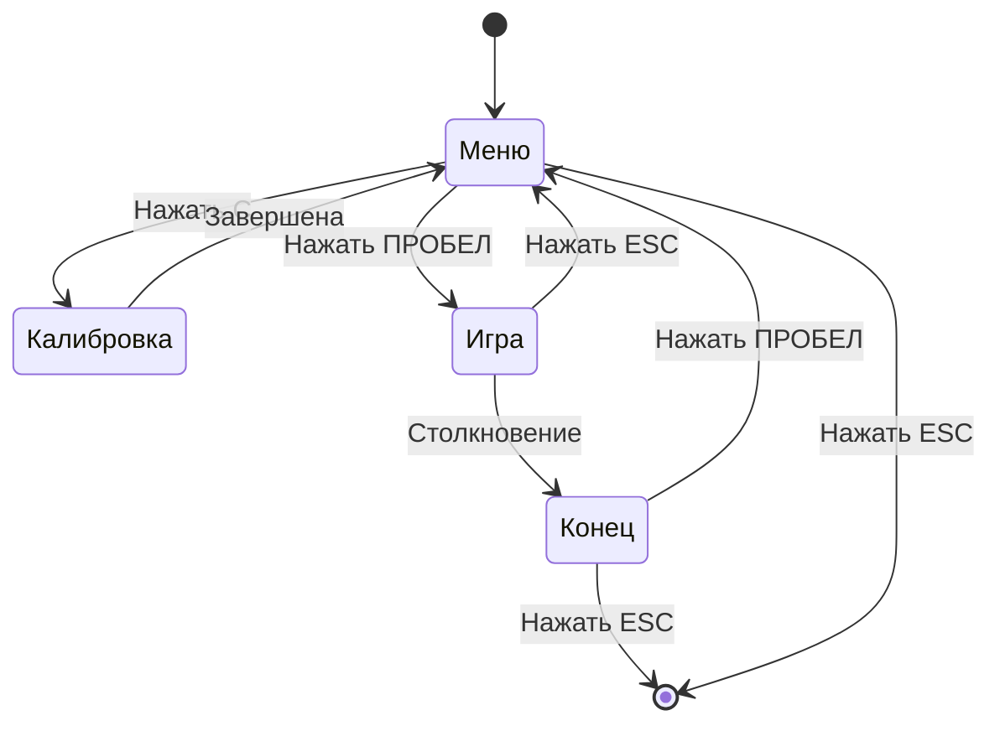
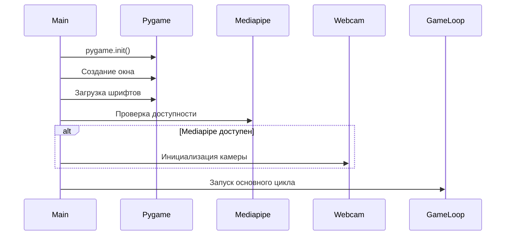

# Face Flappy — Управление головой

Face Flappy — это современная игра в стиле Flappy Bird, где вы управляете птицей, двигая головой! Использует **Pygame** для графики и опционально **Mediapipe** для отслеживания головы через веб-камеру. Также можно играть с помощью клавиатуры.

---

## 🎮 Возможности

- Современный UI с градиентными фонами, мягкими тенями и плавающими пузырями
- Плавная анимация птицы с наклоном крыльев и графикой глаз
- Рандомизированные трубы с пастельными цветами и тонкими бликами
- Отслеживание счета и лучшего результата (сохраняется в `face_flappy_best.json`)
- Отслеживание прыжков головой с помощью **Mediapipe**:
  - Двигайте головой вверх, чтобы птица прыгнула
  - Система калибровки для базового положения головы
  - Резервное управление с клавиатуры (`ПРОБЕЛ` для прыжка, `ESC` для выхода)
- Веб-камера Picture-in-Picture (PiP) для визуальной обратной связи

---

## 📁 Структура проекта

```
Head-Game-main/
├── Head.py                    # Основной файл игры
├── README.md                  # Документация проекта
└── face_flappy_best.json     # Файл сохранения рекорда (создается автоматически)
```

---

## 📄 Описание файлов

### Head.py
**Назначение:** Основной файл игры, содержащий всю логику и графику

**Ключевые компоненты:**
- **Классы:** `Bird`, `Pipe`
- **Функции:** `main()`, `get_head_center_y()`, `draw_text()`, `load_best()`
- **Состояния:** `STATE_MENU`, `STATE_PLAY`, `STATE_OVER`

**Связи:** Единственный файл проекта, содержит всю функциональность

**Логика:** Монолитная архитектура с четким разделением на модули:
- Инициализация и настройки
- Классы игровых объектов
- Система отслеживания головы
- Основной игровой цикл
- Отрисовка UI

---

## 🏗️ Архитектура проекта

### Общая структура

Проект использует **монолитную архитектуру** с модульным разделением внутри одного файла:



### Потоки данных



### Состояния игры



---

## 📚 Библиотеки/фреймворки

| Библиотека | Назначение | Где используется |
|------------|------------|------------------|
| **pygame** | Основной графический движок | Вся графика, события, звук |
| **cv2** | Обработка видео с веб-камеры | Захват кадров, конвертация цветов |
| **mediapipe** | Отслеживание лица | Обнаружение положения головы |
| **numpy** | Математические операции | Обработка координат, сглаживание |
| **json** | Сохранение данных | Рекорды игры |
| **random** | Генерация случайных чисел | Создание труб |
| **math** | Математические функции | Анимация пузырей, тригонометрия |

---

## 🚀 Точка входа и запуск

### Как запускается проект

1. **Инициализация:**
   ```python
   if __name__ == "__main__":
       try:
           main()
       except KeyboardInterrupt:
           # Очистка ресурсов
   ```

2. **Последовательность запуска:**
   - Инициализация Pygame
   - Загрузка шрифтов
   - Проверка доступности Mediapipe
   - Инициализация веб-камеры (если доступна)
   - Запуск основного игрового цикла

### Что выполняется первым



---

## 🎯 Архитектурные особенности

### Нестандартные решения

1. **EMA сглаживание для отслеживания головы:**
   ```python
   _smoothed_y = (1.0 - HEAD_SMOOTH) * y_rel + HEAD_SMOOTH * _smoothed_y
   ```
   - Устраняет дрожание и резкие движения
   - Настраиваемый коэффициент сглаживания

2. **Система калибровки:**
   - Сбор 30 образцов положения головы
   - Вычисление медианного значения как базовой линии
   - Позволяет адаптироваться к разным пользователям

3. **Гибридное управление:**
   - Приоритет отслеживанию головы
   - Резервное управление с клавиатуры
   - Плавный переход между режимами

### Причины выбора архитектуры

1. **Монолитная структура:**
   - Простота разработки и отладки
   - Отсутствие накладных расходов на импорты
   - Легкость распространения (один файл)

2. **Состояния игры:**
   - Четкое разделение логики
   - Простое управление переходами
   - Легкость добавления новых состояний

3. **Объектно-ориентированный подход:**
   - Инкапсуляция логики объектов
   - Переиспользование кода
   - Читаемость и поддерживаемость

---

## 🎮 Игровая механика

### Физика птицы
- **Гравитация:** Постоянное ускорение вниз
- **Прыжок:** Мгновенная отрицательная скорость
- **Ограничения:** Птица не может выйти за границы экрана
- **Наклон:** Визуальный эффект на основе скорости

### Система труб
- **Генерация:** Случайное положение с фиксированным зазором
- **Движение:** Постоянная скорость влево
- **Удаление:** При выходе за левую границу экрана
- **Столкновения:** Проверка пересечения с прямоугольниками

### Подсчет очков
- **Условие:** Птица прошла трубу (x + ширина < позиция птицы)
- **Счетчик:** Уникальный индекс трубы для избежания повторного подсчета
- **Сохранение:** Автоматическое обновление рекорда

---

## 🔧 Настройки и конфигурация

### Основные параметры
```python
WIDTH, HEIGHT = 800, 800      # Размеры окна
FPS = 60                      # Частота кадров
GRAVITY = 0.35               # Сила гравитации
JUMP_VELOCITY = -7.5         # Скорость прыжка
PIPE_GAP = 180               # Зазор между трубами
PIPE_SPEED = 3.5             # Скорость движения труб
```

### Параметры отслеживания головы
```python
HEAD_SMOOTH = 0.15           # Коэффициент сглаживания (0-1)
JUMP_SENSITIVITY = 0.018     # Порог для обнаружения прыжка
CALIBRATION_SAMPLES = 30     # Количество образцов для калибровки
```

### Настройки веб-камеры
```python
WEBCAM_INDEX = 0             # Индекс камеры
WEBCAM_W, WEBCAM_H = 240, 180 # Размеры кадра
```

---

## 🎨 Визуальный дизайн

### Цветовая схема
- **Фон:** Градиент от мягкого синего к румяно-фиолетовому
- **Птица:** Современный желтый с белым свечением
- **Трубы:** Пастельный зеленый с тонкими бликами
- **UI:** Белые карточки с тенями

### Анимации
- **Плавающие пузыри:** Синусоидальное движение для глубины
- **Крылья птицы:** Вращение на основе скорости
- **Градиентный фон:** Статичный, но визуально привлекательный

---

## 🚀 Установка и запуск

### Требования
```bash
pip install pygame opencv-python mediapipe numpy
```

### Запуск
```bash
python Head.py
```

### Управление
- **C:** Калибровка отслеживания головы
- **ПРОБЕЛ:** Прыжок / Начать игру / Вернуться в меню
- **ESC:** Выход / Вернуться в меню

---

## 🔍 Отладка и разработка

### Логирование
Проект не содержит встроенного логирования, но можно добавить:
```python
import logging
logging.basicConfig(level=logging.DEBUG)
```

### Отладка отслеживания головы
- Проверьте доступность веб-камеры
- Убедитесь в достаточном освещении
- Настройте `JUMP_SENSITIVITY` под свои движения

### Производительность
- Игра оптимизирована для 60 FPS
- Отслеживание головы работает в отдельном потоке
- Минимальные требования: Python 3.7+, 2GB RAM

---

## 📈 Возможности расширения

### Планируемые улучшения
- [ ] Звуковые эффекты
- [ ] Различные темы оформления
- [ ] Мультиплеер
- [ ] Система достижений
- [ ] Настройка сложности

### Архитектурные улучшения
- [ ] Разделение на модули
- [ ] Система плагинов
- [ ] Конфигурационные файлы
- [ ] Система сохранений

---

## 🤝 Вклад в проект

1. Форкните репозиторий
2. Создайте ветку для новой функции
3. Внесите изменения
4. Создайте Pull Request

### Стандарты кода
- Следуйте PEP 8
- Добавляйте комментарии на русском языке
- Тестируйте изменения перед отправкой

---

---

Автор: legenda  
Telegram: [@LEGENDA_SD](https://t.me/LEGENDA_SD)
